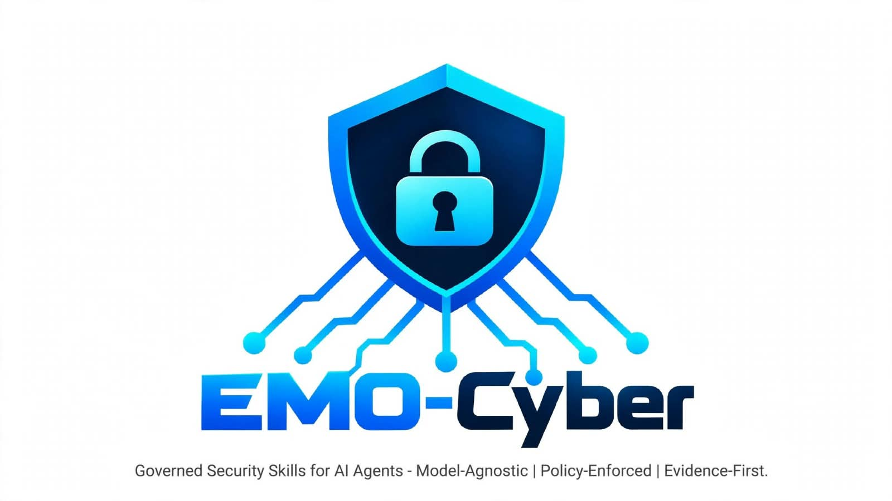

[](https://github.com/SE-Emam/EMO-Cyber-Agent/actions/workflows/ci.yml)
[](https://github.com/SE-Emam/EMO-Cyber-Agent/actions/workflows/runtime-parity.yml)
[](https://pypi.org/project/emo-cyber/)
[](https://pypi.org/project/emo-cyber/)
[](LICENSE)

# EMO-Cyber-Agent — the security subagent your AI stack can actually trust

**Stop letting your coding agent guess about security. Give it a specialist:
scoped read-only audits, evidence-backed findings, and verification plans —
over CLI, MCP, or Python, with zero code changes and zero invented results.**

| | |
|---|---|
| ✅ **2,738 tests green** | Full suite passing, 36/36 schemas valid |
| 🔌 **7 MCP tools** | Works with OpenCode, Pi, Hermes, Jan, AnythingLLM |
| 🖥️ **3 OSs proven** | Live runtime parity: Linux + Windows + macOS |
| 🔒 **Read-only by design** | Default-deny policy engine; it cannot edit your code |

## Get value in 60 seconds

```bash
pip install emo-cyber            # requires Python >= 3.11
cyber-agent audit . --format json > result.json
```

That's it — a machine-checkable security audit of your project. No API keys,
no provider lock-in, no code changes. Then wire it into your agent:

```json
{ "mcpServers": { "emo-cyber-agent": { "command": "cyber-agent", "args": ["mcp"] } } }
```

⭐ **If this saves you one bad merge, star the repo — it keeps the project alive.**

## Who it's for

- **AI agent builders** — your Codex/Cline/OpenCode agent writes fast and
  breaks things fast. Delegate every security question to a governed
  specialist instead of a confident guess.
- **CI / platform teams** — gate merges on stable JSON contracts and
  machine-readable exit codes, not on prose opinions.
- **Security reviewers** — triage evidence-linked findings (with provenance
  and verification plans) instead of chasing hallucinations.

## Why governed security for agents

AI coding agents ship code fast — and every generated diff, prompt,
dependency, and tool call is a new attack surface. Generic assistants
will happily opine about security, but their answers are ungrounded,
unverifiable, and bound to no policy. EMO-Cyber-Agent exists for the
gap in between: a specialist subagent that owns the security workflow,
runs deterministic checks around probabilistic reasoning, and returns
findings your pipeline can actually act on.

## What it does

- **Scoped security audits** of a project tree (`quick`, `standard`, `deep`),
  with focus areas (`auth`, `secrets`, `deps`, …).
- **Focused reviews** of a target, **verification planning** for a
  candidate finding (plans, never exploits), and **evidence-linked reports**
  in JSON, JSONL, or Markdown.
- **Threat-intel lookups** (leak monitor, feed triage, ATT&CK mapping —
  defensive knowledge only, no network calls, no execution) via MCP.
- **Stable JSON contracts** across CLI, MCP, and the Python API, so results
  are machine-checkable in CI.

## What it does not do

- No auto-remediation and no production changes by default.
- No exploit development and no offensive operations.
- Not a replacement for SAST, SCA, secret scanners, DAST, runtime
  security, or human security review.
- No scores-as-verdicts: findings carry evidence and provenance, not ratings.

## EMO-Cyber vs the alternatives

| | Generic AI assistant | Traditional scanner | **EMO-Cyber-Agent** |
|---|---|---|---|
| Grounded in your repo | ❌ guesses | ✅ rules | ✅ **evidence-linked** |
| Understands agent workflows | ❌ | ❌ | ✅ **MCP-native, 7 tools** |
| Policy-enforced (not prompt-suggested) | ❌ | ✅ | ✅ **default-deny engine** |
| Verification before confirmation | ❌ | ⚠️ partial | ✅ **plans + provenance** |
| Model-agnostic, no lock-in | ❌ | ✅ | ✅ **bring any model** |
| Read-only, cannot break prod | ❌ | ✅ | ✅ **by design** |

## Why it is different

1. **Model-agnostic.** No weights, no provider lock-in. The product is the
   methodology, control loop, tool contracts, and evidence model — bring
   any model or run it model-free in CI.
2. **Policy-enforced, not prompt-suggested.** A default-deny `PolicyEngine`
   in Core decides; CLI and MCP are thin adapters that cannot widen
   capabilities, whatever a prompt or tool description claims.
3. **Evidence-first.** No material finding without evidence; tool outputs
   are data, never instructions; repository content is untrusted by default.
4. **Verification before confirmation.** Candidates become plans with
   methods, locators, and rationale — confirmation requires evidence.
5. **Read-only by default.** Destructive actions need an explicit
   permission transition; progress is advisory-only and recovery is
   bounded and fail-closed.

## Architecture

```text
Host / CI / You ──▶ CLI · MCP (stdio + Streamable HTTP) · Python API
                          │  thin adapters, no authority
                          ▼
                   Core: Policy → Tools → Evidence → Reasoning
                              → Verification → Findings → Reporting
```

Core owns every security decision. Deterministic tool adapters (argv-only,
confined, secret-free execution) surround the reasoning loop; the evidence
graph correlates deterministically; the finding lifecycle gates promotion.
Details: `docs/02-architecture.md`, `docs/03-security-methodology.md`.

## Quick start

```bash
pip install emo-cyber            # requires Python >= 3.11
cyber-agent --help
cyber-agent doctor               # presence checks; never prints secrets
cyber-agent audit . --format json > result.json
```

From source (developers):

```bash
pip install -e '.[all]'
```

Docker (reproducible runtime and test target):

```bash
make docker-build
make docker-run
make docker-test
make docker-unit
```

The runtime runs as an unprivileged user with a read-only filesystem, no
Linux capabilities, and no network access. See `docs/docker.md` for the
security model and release-image pinning requirements.

## MCP and integrations

Register once as an MCP server, then delegate from any compatible host:

```json
{ "mcpServers": { "emo-cyber-agent": { "command": "cyber-agent", "args": ["mcp"] } } }
```

Seven tools (the last opt-in): `cyber_audit`, `cyber_review`,
`cyber_verify`, `cyber_report`, `cyber_status`, `cyber_extensions`,
`cyber_threat_intel`. Transports: stdio plus Streamable HTTP
(localhost by default, with Host/Origin/session validation).
Per-host guides: `docs/integrations/` (OpenCode, Pi, Hermes, Jan,
AnythingLLM, generic MCP, delegation rules, security model).

| Host | Status |
|---|---|
| Generic MCP host (stdio) | Contract Tested |
| OpenCode | Supported (config), Contract Tested discovery |
| Pi (stdio / Streamable HTTP) | Supported (config), project-scoped |
| Hermes (per-server filtering) | Supported (config), least-surface guidance |
| Jan (Desktop + Agent/CLI shared config) | Supported (config) |
| AnythingLLM (workspace/RAG = untrusted inputs) | Supported (config), boundary guidance |

Levels: Supported = config + mapping shipped; Contract Tested = in-repo
contract tests; Environment Tested = live binary exercised (where available);
otherwise Not Tested — see `docs/integrations/` per host.

## Example workflow: an authorized audit, end to end

```bash
# 1. Check operational presence (no secrets printed).
cyber-agent doctor

# 2. Run a scoped, read-only audit; findings never change the exit code.
cyber-agent audit ./my-service --mode standard --format json > audit.json
python -c "import json; print(json.load(open('audit.json'))['result']['status'])"

# 3. Request a verification plan for a candidate (input is never authorization).
cyber-agent verify --candidate cand.json --method static-review \
  --kind sast --locator src/auth/login.py:42 --rationale "unverified input reaches query" \
  --audit-id <id-from-audit.json>

# 4. Render the evidence-backed report for humans or the pipeline.
cyber-agent report --findings findings.json --audit-id <id> --format markdown
```

Exit codes stay machine-readable and separate from findings:
`0` success · `1` audit/domain failure · `2` invalid input ·
`3` policy denied · `4` security blocked · `5` provider/tool unavailable ·
`6` verification inconclusive · `7` internal error.

## Commands

```text
cyber-agent doctor | audit | review | verify | status | report | extensions | mcp
```

`audit` takes `--mode quick|standard|deep`, `--focus a,b`,
`--format human|json`, and `--output PATH`. Only implemented options
exist — there are no `--shell`, `--exec`, `--grant`, `--sudo`,
`--allow-write`, or `--bypass-policy` flags, and no secret-valued flags
(use environment or secret providers).

## Platform parity (evidence-first)

Live runtime proof, not CI-smoke claims. Method: real runners, real
installs, real CLI/MCP/HTTP/security batteries — green run
[#37866150660](https://github.com/SE-Emam/EMO-Cyber-Agent/actions/runs/37866150660).
Per-platform evidence lives in `docs/evidence/`:

| Platform | Status |
|---|---|
| Linux (ubuntu-24.04, Python 3.11 + 3.14) | **Runtime PASS** — 234/234 checks ×2 combos (wheel + sdist + PyPI origins; `POST-T021-linux-parity.md`) |
| Windows (windows-2025, Python 3.11 + 3.14) | **Runtime PASS** — 234/234 ×2 combos; live PowerShell session NOT-EXECUTED, documented gap (`POST-T021-windows-parity.md`) |
| Android emulator (API 34, ARM64) via Termux | **PASS** — install + CLI/MCP/HTTP/security/E2E + independent review; verified working, not an officially supported platform (`POST-T021-android-assessment.md`) |
| macOS (arm64) | **PASS** — full suite 2720 passed / 0 failed + live CLI/MCP checks (`POST-T021-regression.md`) |

Honestly open (never inflated to PASS): Pi/Jan native delegation and
AnythingLLM adversarial-via-host are `ENVIRONMENT-BLOCKED` with reproducible
reasons; test-key rotation is `LOW / OPEN` (operator step). See
`docs/evidence/POST-T021-final-review.md`.

## Limitations

Read-only analysis; no auto-remediation, no exploit capabilities, no
scores-as-verdicts. Live-host interop beyond contract tests is
environment-dependent (see host docs). Progress never gates security
decisions; recovery never mutates policy, evidence, or findings.

`FoundationSecurityAuditor.audit` currently invokes locally installed Gitleaks
through the strict read-only tool boundary and returns redacted scanner
observations as evidence. It remains `partial`: Semgrep is intentionally not
run until offline rule configuration is verified, Trivy and OSV-Scanner are
not part of this local path, and finding classification/full control coverage
are not implemented. `review` and `verify` remain partial stubs. A successful
CLI process or an empty findings list is not a completed security assessment.

## Verification and tests

```bash
make test                         # full suite (pytest, ~2 min)
python -m pytest tests/unit -q    # unit scope only
```

Release-gate checks live in `tests/release/`; benchmark corpus sanity in
`tests/unit/test_benchmark_*.py`. Every material finding requires evidence;
verification precedes confirmation — see `docs/03-security-methodology.md`.

## Reference documentation

- Specs and contracts: `docs/` (`02-architecture.md`, `05-mcp-interface.md`,
  `06-cli-interface.md`, `07-python-api.md`, `08-tool-contracts.md`).
- Host guides: `docs/integrations/` (OpenCode, Pi, Hermes, Jan, AnythingLLM,
  generic MCP, delegation rules, security model).
- Threat model and guardrails: `docs/13-threat-model.md`,
  `docs/14-safety-guardrails.md`, `docs/policies/`.
- Release provenance: `CHANGELOG.md` and `docs/evidence/`.
- Contributing: `CONTRIBUTING.md`.

## Security vulnerabilities

Do not open a public issue for a suspected vulnerability. Report it
privately as described in `SECURITY.md`.

## Contribute — help secure the agent era

Good first issues: host guides, benchmark cases, docs. PRs are reviewed
against the same evidence bar the product enforces.

```bash
git clone https://github.com/SE-Emam/EMO-Cyber-Agent.git
cd EMO-Cyber-Agent && make check
```

See `CONTRIBUTING.md`. If the project helps you, ⭐ star it —
discoverability is our growth engine.

## License

Apache-2.0 — see `LICENSE`.
